# 서울시 출퇴근 교통혼잡 완화를 위한 AI 기반 혼잡구간 분석 및 맞춤형 교통수요 관리 정책

> 2026년 교통문제 해결 데이터 분석 공모전 제출용 분석보고서 (초안 · 2026-10-19)
>
> **표기 원칙** — 🟦 **실측 분석**: 공공데이터 관측값으로 계산한 결과 · 🟧 **가정 기반 시뮬레이션**: `config/simulation.yaml`의 가정값에 따라 달라지는 결과.
> 모든 그림의 수치는 `outputs/tables/fig_*.csv`, 시뮬레이션 수치는 `outputs/tables/sim_*.csv`에 있다.

---

## 요약

- 🟦 서울 도로의 **퇴근 18~19시 정체 연장비율은 27.8%**, **출근 08~09시는 19.3%**로, 혼잡은 퇴근이 더 넓고 출근은 08~09시 한 시간에 집중된다. 교통량(58.7만 대/시)과 지하철 하차(60만 명/일 기준 시간대) 모두 08~09시가 최대다.
- 🟦 혼잡은 공간적으로 고르지 않다. 출근은 강북·은평·도봉·중구(약 21 km/h), 퇴근은 중구(17 km/h)·강남·강서가 가장 느리다. 출근시간 대중교통 순유입은 강남(+15.3만)·중구(+9.5만)·종로(+7.0만)에 집중된다.
- 🟦 같은 지점 안에서 교통량과 속도는 강한 음의 관계(스피어만 ρ 중앙값 -0.79 ~ -0.84)를 보이며, 이를 근거로 도로 등급별 속도-교통량 탄력성(-0.21 ~ -0.28)을 추정했다.
- 🟧 **서울 전역 홀짝제(B)**는 첨두 승용차 통행의 **15~34%를 제한**해야 하며(50%가 아님: 예외차량·순응률·시간 이동 반영), 첨두 평균속도는 +2.6~+18%(실측 탄력성) 또는 +22~+45%(BPR) 개선되지만 **첨두 앞뒤 시간이 1~10% 느려지고**, 높은 가정에서 대중교통 승차가 전 자치구에서 10.8% 늘어난다.
- 🟧 **혼잡지역 선택 관리(C)**는 승용차 주행거리를 1~3%만 줄이면서 **대상 지역 속도를 +1.2~+7.5%(탄력성) / +11~+25%(BPR)** 개선한다. 줄인 주행거리 1%당 속도 개선 효율은 홀짝제와 비슷하지만, 제한받는 통행이 약 1/10 수준이라 사회적 비용이 작다. 인접 지역은 우회 유입으로 0.1~1.6% 느려진다.
- 🟧 **버스 증편(D)** 단독 효과는 작지만(+0.03~+1.5%), 도로가 느리고 출근 유출이 큰 주거지 8개 자치구의 대체 수단을 보강해 C의 형평성 문제를 줄인다.
- 🟦 2년치 교통량으로 보면 출근 교통량은 평일 요일 간 차이가 1% 이내이고 계절 변동도 ±5% 수준이라 **첨두 혼잡은 연중 구조적**이다. 비가 오면 교통량은 3~11% 줄어든다.
- 🟦 **AI 예측**: 첨두 지점 교통량을 1시간 전에 예측하는 모델(XGBoost·LightGBM)이 시험기간(2025 하반기) MAE를 베이스라인 대비 약 45% 줄였다(322 → 175대/시). 고수요 판정(F1 0.66 vs 0.62)의 개선은 작다.
- **제안**: 전면 홀짝제 대신 **"혼잡 핵심지역 첨두 한정 수요관리 + 주거지 버스 보강(E)"**을 단계적으로 시범 도입하고, AI 예측으로 첨두 교통량을 1시간 전에 예측해 운영(버스 배차·관리 강도)을 조정한다.

---

## 1. 연구 배경과 질문

서울은 출퇴근 시간 도로 혼잡이 반복되며, 차량 홀짝제·버스 증편 같은 정책 아이디어가 제시되어 왔다. 본 연구는 **홀짝제의 효과를 미리 전제하지 않고** 공공데이터로 혼잡의 시간·공간 구조를 확인한 뒤, 여러 정책을 같은 기준으로 비교한다.

| 연구 질문 | 답한 절 |
|---|---|
| Q1. 혼잡이 가장 심각한 지역과 시간대는? | 4.1, 4.2 |
| Q2. 혼잡과 교통량·요일·날씨·대중교통 수요의 관계는? | 4.3, 4.4 |
| Q3. 홀짝제·선택적 수요관리가 혼잡을 줄일 가능성은? | 6 |
| Q4. 늘어나는 대중교통 수요를 수용할 수 있는가? | 6.4 |
| Q5. 편의성·형평성·환경을 함께 고려한 최적 정책은? | 6.5, 7 |

## 2. 데이터

| 데이터 | 출처 | 기간·범위 | 용도 |
|---|---|---|---|
| 1시간 소통정보(구간별) | 서울 교통빅데이터플랫폼 | 2026-10-14 01시 ~ 10-15 09시, 링크 5,114개 | 도로 속도·혼잡 |
| TOPIS 서비스링크 형상 | 서울 열린데이터광장 `LinkVerInfo` | 5,114개 | 링크 지도화·자치구 매핑 |
| 표준노드링크 | ITS 국가교통정보센터 (2026-10-14판) | 서울 63,411개 링크 | 차로수·제한속도 |
| 교통량 이력 | 열린데이터광장 `VolInfo` | 139개 지점, 2026-10-14·15 전 시간 / 2024~2025 첨두 전후 7개 시각 | 교통량, AI 예측 |
| 스마트교차로 1시간 교통량 | 서울 교통빅데이터플랫폼 | 2026-09-19 ~ 10-18, 노원구 5곳 | 요일 유형 비교 |
| 지하철·버스 시간대별 승하차 | 열린데이터광장 `CardSubwayTime`, `CardBusTimeNew` | 2024-01 ~ 2026-09 월 합계 | 대중교통 수요 |
| 정류소·역 좌표 | 열린데이터광장 `busStopLocationXyInfo`, `subwayStationMaster` | 11,236 / 784개 | 자치구 매핑 |
| 기상 ASOS 시간자료 | 기상청(공공데이터포털), 서울 108 | 2024-01 ~ 2026-10-18 | 강수 |
| 공휴일 | 한국천문연구원 특일 정보 | 2024~2026 | 요일 구분 |
| 행정구역 경계 | 통계청 SGIS (2025 2Q) | 자치구 25, 행정동 426 | 공간 집계 |

상세: `docs/data_sources.md`. 라이선스는 대부분 공공누리 제1유형(출처표시).

**가장 큰 제약**: 도로 속도 자료가 평일 33시간뿐이다. 따라서 계절·요일·강수가 **속도**에 미치는 영향은 추정하지 않았고, 장기 분석과 AI 예측은 2년치가 있는 **교통량**으로 수행했다.

## 3. 전처리

상세 규칙과 품질 점검표: `docs/preprocessing_log.md`, `outputs/tables/quality_*.csv`.

- **시간 기준 통일**: 모든 자료를 "1시간 구간의 시작 시각(`hour_start`)"으로 맞췄다. 소통정보 시간코드 `08`(`~8시`)는 07시 구간, 기상 강수 `08:00`도 07시 구간이다.
- **출퇴근 구분**: 원문 정의(출근 08~10시, 퇴근 17~19시). TOPIS 첨두(07~09시)는 비교용으로 보존.
- **평일·주말·공휴일**: 특일 정보 API(대체·임시공휴일 포함).
- **링크 매핑 문제 해결**: 소통정보 링크ID는 국가 표준링크가 아닌 TOPIS 서비스링크로, 직접 결합 시 70.5% 불일치. 서비스링크 형상을 API로 받아 공간 매칭 → 자치구·행정동 98.9%, 차로수·제한속도 99.0% 매핑.
- **원본 오류 발견·수정**: 지하철 승하차 API가 2026-03, 2026-07을 통째로 중복 제공(1,241행). 집계 단계가 중복을 가리므로 원본에서 제거.
- **결측·이상치**: 평균 대체 없음. 속도 0 이하·제한속도 1.5배 초과(0.23%)는 플래그 후 분석 제외. 강수 공란은 ASOS 무강수 관례로 0 처리하고 원래 공란 여부를 보존.
- **통합 가능성 검증**: 소통정보와 대중교통은 기간이 겹치지 않아(대중교통 최신 2026-09) 시간 단위 결합을 하지 않고 자치구×시간대 **패턴 비교**만 수행했다.

## 4. 탐색적 데이터 분석 🟦

그림: `outputs/figures/` (PNG 300dpi + SVG), 인터랙티브: `outputs/html/`.

### 4.1 언제 막히는가

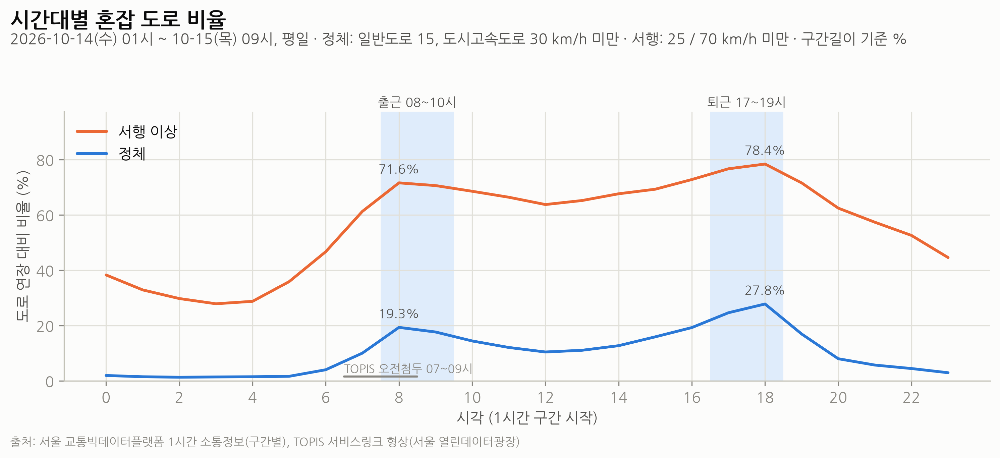

- 정체(일반도로 15, 도시고속도로 30 km/h 미만) 연장비율은 **퇴근 18~19시 27.8%**, 출근 08~09시 19.3%가 최대다.
- 교통량 지점 합계도 08~09시 58.7만 대/시가 최대(A04), 지하철 하차도 08~09시 60만 명(C01). **출근 혼잡은 08~09시 한 시간에 집중**되고 09~10시는 이미 감소한다. 원문 정의(08~10시)와 TOPIS 정의(07~09시) 모두 이 시간을 포함하므로, 정책 시간대 설계 시 08~09시를 핵심으로 본다.
- 도시고속도로는 새벽 약 82 → 퇴근 약 45 km/h로 하락 폭이 가장 크다(A01).

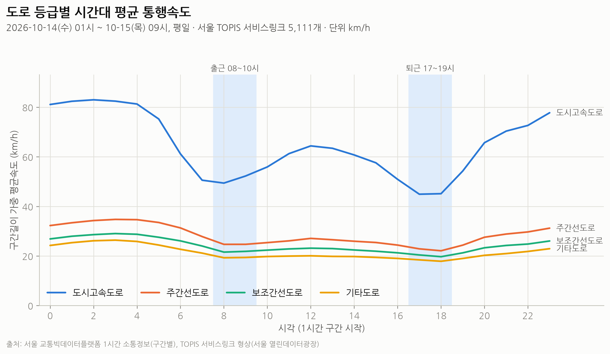

### 4.2 어디가 막히는가

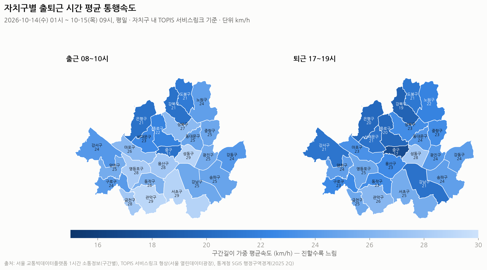

- 출근 느린 자치구: 강북·은평·중구(약 21 km/h), 도봉·종로. 퇴근: 중구 17 km/h, 강북 19, 은평·종로 20 km/h.
- 퇴근시간에는 강남 격자 도로망 전체로 정체가 확산된다(B04). 출근은 도심 진입축과 북부 간선에 분포한다.
- 출근시간 최저속도 구간(300m 이상): 화곡로 부천시계→화곡로입구 6.3 km/h, 청계천로 청계8가→7가 6.6 km/h 등(B03, 2일 평균이라 변동 가능).

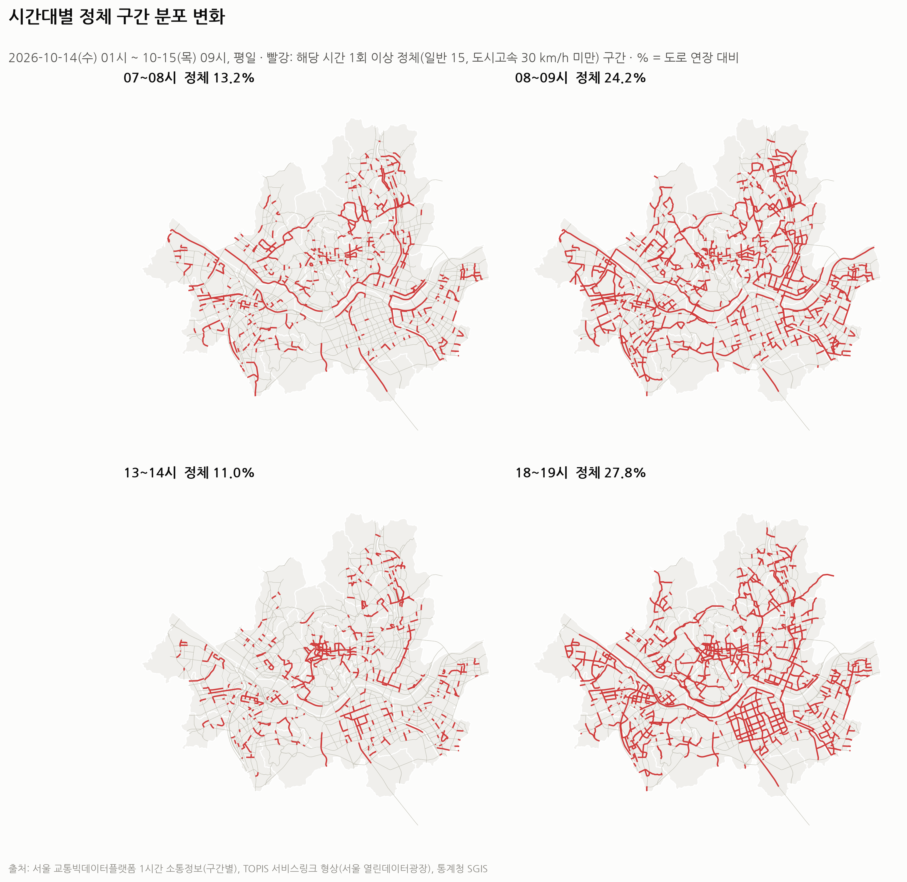

### 4.3 대중교통 수요

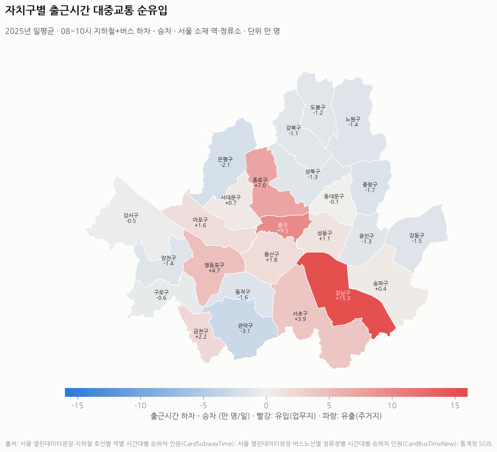

- 출근 08~10시 대중교통 하차-승차(2025년 일평균): 강남 +15.3만, 중구 +9.5만, 종로 +7.0만, 영등포 +4.7만 → **업무지**. 관악 -3.1만, 은평 -2.1만 → **주거지**.
- 월별 일평균 승차는 지하철 약 500~600만, 버스 약 380~490만 명이며 매년 1월이 최저다(C02).
- 🟦 **추가 대중교통 수요 후보(탐색 지표)**: 도로가 느리고 출근 유출이 큰 은평·강북·도봉·강동·서대문·강서·노원·구로(C06). 지표 가중치(1:1)는 가정이다.

### 4.4 교통량·요일·날씨

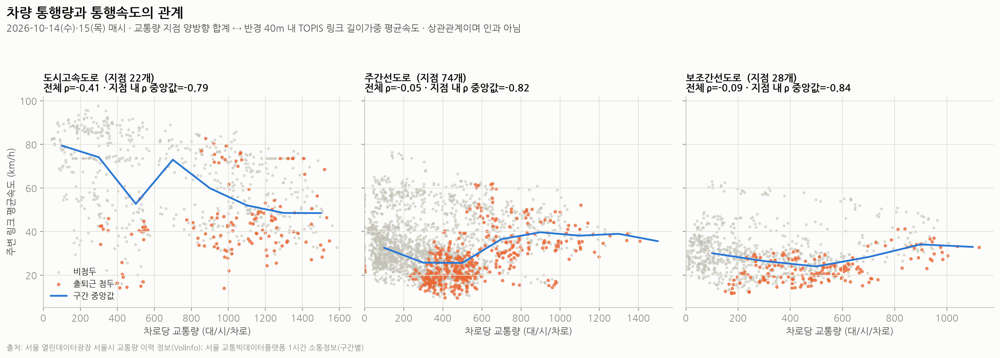

- 지점을 섞으면 간선도로의 교통량-속도 상관이 약하다(ρ≈-0.05). 넓은 도로일수록 교통량도 많고 속도도 빠르기 때문이다. **같은 지점 안에서는 ρ 중앙값 -0.79 ~ -0.84**로 강하다. 따라서 정책 효과는 지점·구간 단위의 관계로 추정해야 한다.
- 간선도로 첨두 관측점은 "교통량 중간·속도 낮음" 영역에 몰린다. 교차로 용량 제약(과포화)을 시사하며, 교통량을 줄였을 때의 효과가 비선형일 수 있다. 이것이 시뮬레이션에 두 가지 속도 모형을 쓰는 이유다.
- 노원구 5개 교차로(30일): 평일은 07~09시 급증, 주말·공휴일은 출근 첨두가 없고 오후에 최대(A05).

장기 교통량(2024-01-01~2025-12-31 중 725일; 6일은 원천에 자료 없음)으로 요일·강수·월별 차이를 봤다. 07~19시 교통량 0(1.9%, 특정 지점에 연속 발생)은 검지기 장애로 보고 결측 처리했고, 날짜·시간의 95% 이상 관측된 **104개 지점**의 합계를 쓴다.

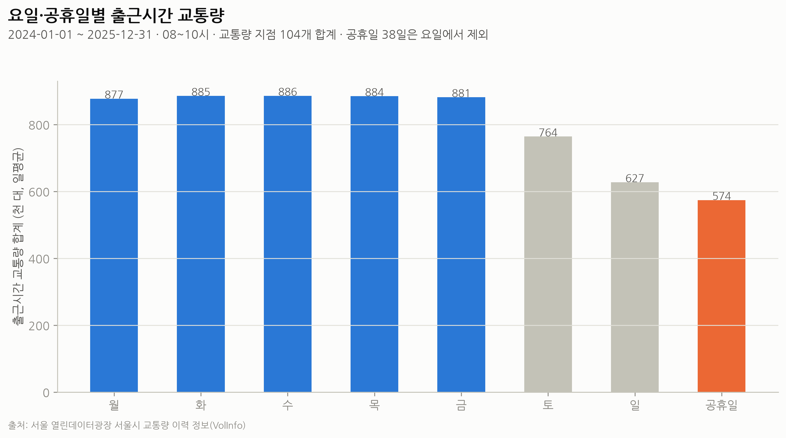

- 출근 2시간(08~10시) 교통량은 평일 요일 간 차이가 1% 이내(87.7만~88.6만 대)다. 토요일은 평일 평균보다 13.5%, 일요일은 28.9%, 공휴일은 35.0% 적다. **요일보다 '근무일 여부'가 출근 교통량을 결정한다.**

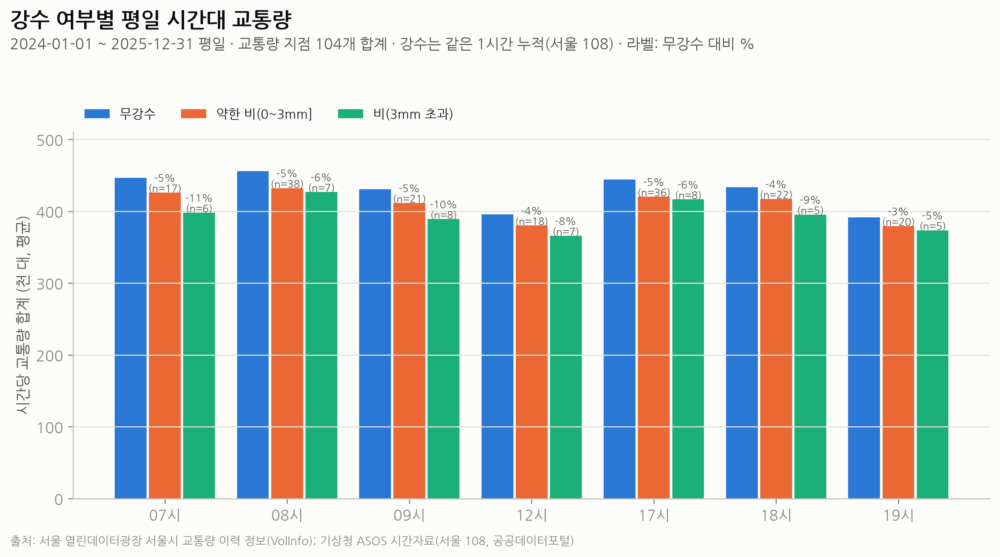

- 평일 같은 시간에 비가 오면 교통량이 약한 비(0~3mm)에서 3~5%, 3mm 초과에서 5~11% 적다. 3mm 초과는 시간대별 5~8시간뿐이라 불확실성이 크다. 비 오는 날 체감 혼잡이 커지는 것은 교통량 증가가 아니라 속도 저하 때문일 가능성이 있으나, 속도 자료(33시간, 강수 없음)로는 확인할 수 없다.

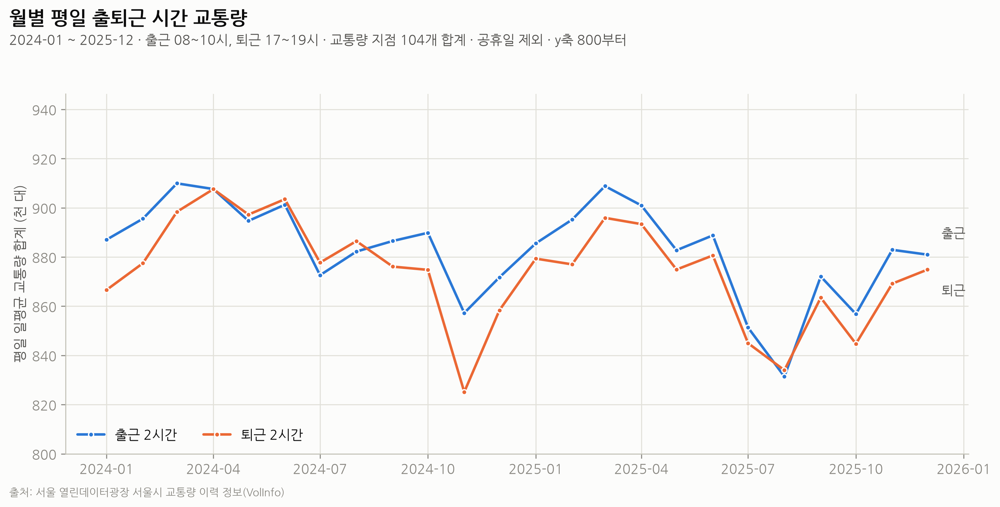

- 월별 평일 출퇴근 교통량은 83만~91만 대로, 평균 대비 약 ±5% 범위다. 3~4월이 높고 휴가철(2025-08)과 2024-11이 낮다. 2024-11 감소의 원인은 확인하지 않았다(같은 달 말 폭설 등 확인 필요). **계절 변동이 작아 첨두 혼잡은 연중 구조적 문제**로 볼 수 있다.

## 5. AI 기반 교통혼잡 예측

### 5.1 문제 정의 (EDA 결과에 따른 변경)
원문은 "도로별 다음 시간대 평균속도"를 우선 대상으로 제시했으나, 속도 자료가 33시간뿐이라 시간 순서에 따른 학습·검증·시험 분할이 불가능하다. 따라서 2년치가 있는 **교통량 지점 139곳의 출퇴근 첨두(08·09·18·19시) 교통량을 1시간 전에 예측**하는 문제로 정의했다.

- 회귀: MAE, RMSE, MAPE
- 분류: 고수요 여부(지점·시각별 학습기간 80분위 초과) — F1, Precision, Recall
- 분할: 학습 2024 / 검증 2025-01~06 / 시험 2025-07~12 (시간 순서)
- 비교: 베이스라인(지난주 같은 시각, 지점·시각·요일 평균) vs Random Forest, XGBoost, LightGBM
- 누수 점검: 시차 변수는 모두 과거, 타깃 인코딩·임계값은 학습기간만, 강수는 직전 시간까지만
- SHAP으로 예측 영향 요인 분석 — 예측 기여도이며 인과 효과가 아님

- 전처리: 07~19시 교통량 0(2.2%, D-46·D-27·B-22 지점에 집중)은 검지기 장애로 보고 타깃·시차 변수에서 제외. 차로 구성(행 수)이 바뀐 관측도 제외.
- 표본: 학습 141,398 / 검증 77,488 / 시험 71,598건(지점·시각), 지점 139개. 하이퍼파라미터는 검증 MAE로 각 4개 조합 중 선택.

### 5.2 결과

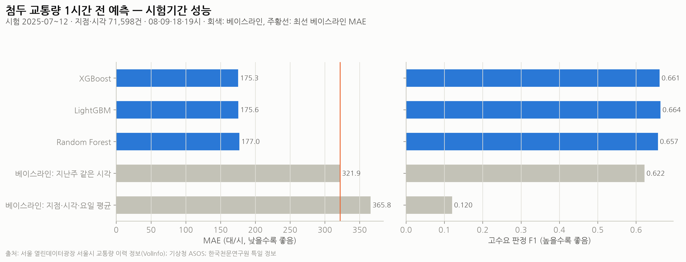

| 모델 (시험 2025-07~12) | MAE (대/시) | RMSE | MAPE | 고수요 F1 | Precision | Recall |
|---|---:|---:|---:|---:|---:|---:|
| 베이스라인: 지난주 같은 시각 | 321.9 | 623.5 | 25.9% | 0.622 | 0.615 | 0.630 |
| 베이스라인: 지점·시각·요일 평균 | 365.8 | 605.7 | 31.0% | 0.120 | 0.528 | 0.068 |
| Random Forest | 177.0 | 283.5 | 12.5% | 0.657 | 0.769 | 0.573 |
| XGBoost | **175.3** | 277.8 | 14.1% | 0.661 | 0.766 | 0.582 |
| LightGBM | 175.6 | **277.1** | 14.0% | **0.664** | 0.754 | 0.593 |

- 세 모델 모두 최선 베이스라인보다 **MAE를 약 45% 줄였다**(321.9 → 175.3대/시, 지점 평균 교통량 약 3,750대/시의 4.7%). 모델 간 차이는 1% 이내로, 모델 종류보다 특징(직전 시간·지난주 교통량)이 성능을 좌우한다.
- **고수요 판정 개선은 작다**: F1 0.622 → 0.664. 정밀도는 0.61 → 0.75~0.77로 높아졌지만 재현율은 0.63 → 0.57~0.59로 오히려 낮다. 고수요 경보 용도로는 베이스라인 대비 우위가 제한적이다.
- 평균 베이스라인의 F1이 0.12로 낮은 것은 2025년 하반기 교통량이 2024년보다 적어 학습기간 기준 80분위를 넘는 경우가 드물기 때문이다(D04). 시험기간 MAE(175)가 검증기간(160)보다 큰 것도 같은 추세 변화의 영향으로 보인다.

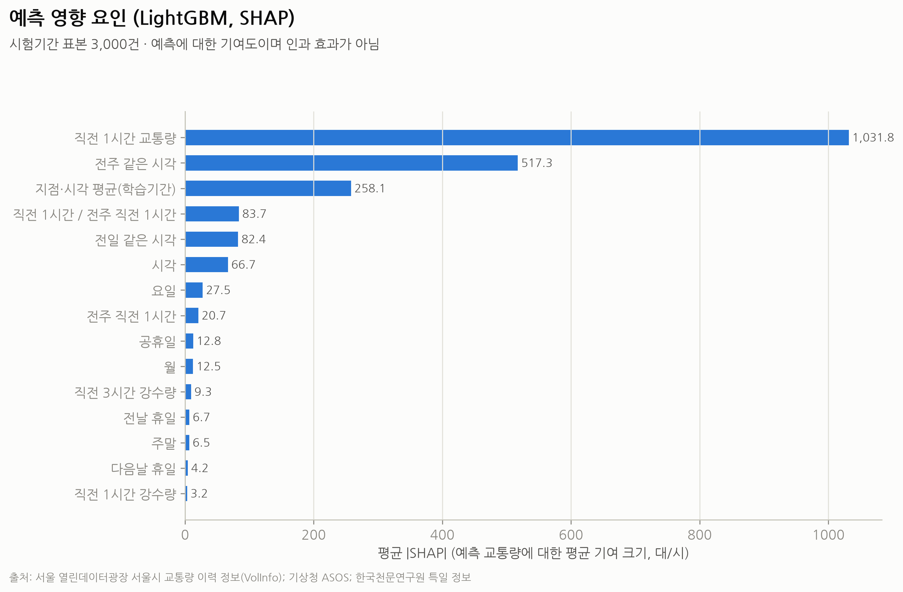

- SHAP 기여도는 직전 1시간 교통량(1,032) > 지난주 같은 시각(517) > 지점·시각 평균(258) 순이며, 강수(3~9)·휴일 변수는 작다. 강수가 교통량을 3~11% 줄이는 관계(D03)가 있어도, 직전 시간 교통량에 이미 반영되어 추가 정보가 적은 것으로 해석된다. **예측 기여도이며 인과 효과가 아니다.**

### 5.3 정책 의사결정에서 AI의 역할
- 1시간 전 교통량 예측 오차가 지점 평균의 약 5%로, **운영 보조**(첨두 직전 버스 예비차 투입, 선택 관리 구역의 안내·관리 강도 조정)에는 쓸 만한 수준이다.
- 반면 고수요 '판정'은 베이스라인보다 조금 나을 뿐이므로, 경보 기준은 예측값과 단순 규칙(지난주 같은 시각)을 함께 보는 방식이 안전하다.
- 이 모델은 **정책 효과를 추정하지 않는다**. 정책 효과는 6절의 가정 기반 시뮬레이션으로 따로 다룬다.

## 6. 정책 효과 분석 🟧

> 이 절의 모든 수치는 **가정 기반 시뮬레이션**이다. 기준선(A)은 2026-10-14·15 관측 속도이며, 가정값은 `config/simulation.yaml`에 표로 공개했다. 실제 시행 효과를 확정적으로 예측하지 않는다.

### 6.1 방법

1. **교통량 변화율**: 시나리오·가정 수준(낮음/중간/높음)별로 링크·시각 교통량 배수 *m*을 만든다.
   - B 홀짝제: 제한 비율 = 승용차 비중 × (1 - 예외차량) × 0.5 × 순응률 → **15~34%** (중간 24%). 제한 차량 중 일부(10~40%)는 첨두 앞뒤 시간으로 이동한다.
   - C 선택 관리: 첨두 정체 연장비율 상위 6개 자치구(출근: 광진·강서·종로·서대문·양천·중구 / 퇴근: 강남·중구·종로·광진·강서·중랑)에서 승용차 10~20% 감소. 감소분의 10~30%는 인접 자치구로 우회한다.
   - D 버스 증편: 추가 수요 후보 8개 자치구에서 승용차 1~4% 전환, 버스 공급 +10%.
   - E: C + D.
2. **속도 반응**(두 모형으로 범위 제시):
   - 방법 1 — **실측 탄력성**: v₁ = v₀·m^ε. ε는 지점 내 로그-로그 회귀로 추정했다(06~21시, 도로 등급별, 부트스트랩 95% 구간을 낮음/높음으로 사용).
   - 방법 2 — **BPR**: t = t₀(1 + 0.15·x⁴). 관측 통행시간비로 기준 포화도 x₀를 역산한다. 과포화 링크에서 효과가 크게 나오는 상한 성격이다.
3. **대중교통 추가수요**: 자치구별 첨두 대중교통 승하차(2025 실측) × 승용차/대중교통 비율(0.3~0.5, 가정) × 감소 비율 × 대중교통 전환율(0.5~0.7, 가정).
4. **CO2**: 주행거리(VKT) 변화율로 대리한다. 속도에 따른 배출계수 변화는 반영하지 않았다(배출계수 곡선 공식 자료 미확보).

### 6.2 시나리오 비교

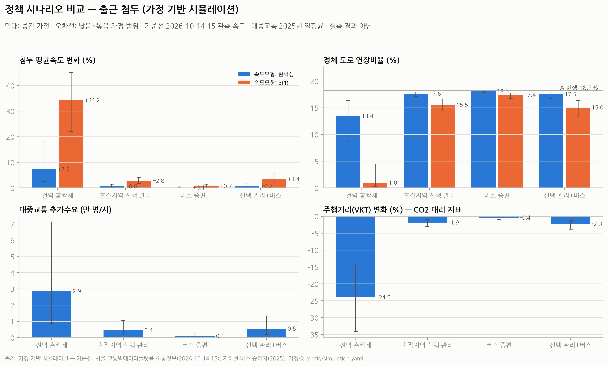

| 지표 (출근, 낮음~높음 가정) | B 전역 홀짝제 | C 선택 관리 | D 버스 증편 | E 선택+버스 |
|---|---|---|---|---|
| 서울 평균속도 변화 — 탄력성 | +2.6 ~ +18.3% | +0.2 ~ +1.4% | +0.03 ~ +0.4% | +0.2 ~ +1.8% |
| 서울 평균속도 변화 — BPR | +22 ~ +45% | +1.6 ~ +4.2% | +0.3 ~ +1.4% | +1.9 ~ +5.5% |
| 대상지역 속도 변화 — 탄력성 / BPR | (전역) | +1.2 ~ +7.5% / +11 ~ +25% | +0.1 ~ +1.4% / +1.1 ~ +5.0% | +1.2 ~ +8.0% / +12 ~ +27% |
| 우회 유입지역 속도 변화 | — | -0.1 ~ -1.3% | — | -1.0 ~ +0.1% |
| 첨두 앞뒤 시간 속도 변화 | **-1.0 ~ -8.4%** | 0 | 0 | 0 |
| 승용차 주행거리(CO2 대리) | -15 ~ -34% | -1.0 ~ -3.0% | -0.2 ~ -0.9% | -1.2 ~ -3.9% |
| 대중교통 추가수요(인/시) | 0.9만 ~ 7.1만 | 0.15만 ~ 1.0만 | 0.03만 ~ 0.28만 | 0.18만 ~ 1.3만 |

퇴근도 같은 경향이다(`F01_시나리오비교_퇴근.png`, `sim_results.csv`).

### 6.3 해석

- **홀짝제는 효과의 크기가 가장 크지만 그만큼 많은 통행을 제한한다.** 같은 모형에서 "줄인 주행거리 1%당 속도 개선"은 B(탄력성 0.30, BPR 1.43)와 C(0.29, 1.48)가 거의 같다. 즉 C는 **훨씬 적은 통행 제한으로 혼잡이 심한 곳에 효과를 집중**한다.
- 홀짝제는 운행 시간을 바꾼 차량 때문에 **첨두 앞뒤 시간(07·10·16·19시)이 느려지는 풍선효과**가 생긴다.
- 선택 관리는 인접 지역으로 우회 유입이 생기지만, 그 크기(-0.1~-1.6%)는 대상 지역 개선보다 한 자릿수 이상 작다.
- 두 속도 모형의 차이가 크다(예: B 평균속도 +7% vs +34%). 이는 과포화 구간의 반응 불확실성을 반영한 것으로, 실제 효과는 시범사업으로 검증해야 한다.

### 6.4 대중교통 수용 가능성 (Q4)

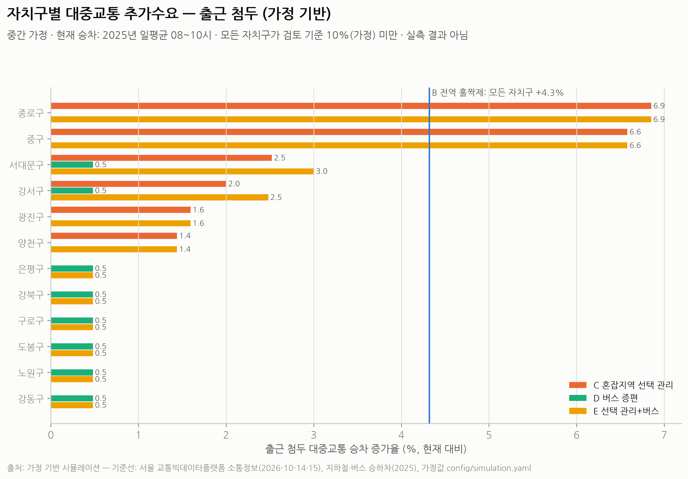

- 중간 가정에서 모든 시나리오의 자치구별 승차 증가율은 검토 기준(10%, 가정) 미만이다. B는 전 자치구 +4.3%, C는 종로 +6.9%·중구 +6.6%에 집중된다.
- **B의 높은 가정에서는 전 자치구가 +10.8%로 기준을 넘는다.** 서울 전역의 첨두 대중교통 증강이 함께 필요하다.
- 한계: 차량·노선별 수송능력(지하철 칸별 혼잡도, 버스 정원)을 확보하지 못해 "초과수요"를 확정하지 않고 증가율로만 판단했다.

### 6.5 형평성·환경 (Q5)

- 🟧 E는 추가 수요 후보 8개 자치구(주거지·도로 혼잡)의 출근 속도를 +0.4~+3.3%(탄력성) 개선하고 대체 수단(버스)을 보강한다. C 단독일 때 대상지역 밖 주거지 통근자가 받을 불편을 줄인다.
- 🟧 CO2(주행거리 대리)는 B가 가장 크게 줄지만(-15~-34%), 첨두 앞뒤 시간 이동분은 배출이 사라지는 것이 아니라 시간만 옮겨가므로 실제 감축은 이보다 작다.
- 교통약자 영향은 연령·장애 관련 공간자료를 확보하지 못해 정량화하지 못했다(한계).

## 7. 정책 제안

### 7.1 제안: 혼잡 핵심지역 첨두 한정 수요관리 + 주거지 버스 보강 (시나리오 E)

| 항목 | 내용 |
|---|---|
| 문제의 근거 🟦 | 퇴근 정체 27.8%, 출근 08~09시 집중. 혼잡이 도심(종로·중구)과 일부 자치구에 공간적으로 집중됨 |
| 정책 필요성 | 전역 일률 규제는 혼잡하지 않은 곳·시간의 통행까지 제한해 사회적 비용이 큼 |
| 기존 정책과 차별성 | 전면 홀짝제(전 지역·전 차량) 대신 **데이터로 선정한 지역·시간**에 한정, 주거지 대체수단을 함께 공급 |
| 적용 대상 | 출근·퇴근 모두 혼잡 상위인 **종로·중구**를 1단계 핵심, 광진·강서 등은 2단계 후보. 버스 보강: 은평·강북·도봉·강동·서대문·강서·노원·구로 |
| 적용 시간 | 출근 08~09시 핵심(원문 08~10시 중 실측 최대), 퇴근 17~19시 |
| 시행 단계 | ① 1단계(6개월): 종로·중구 첨두 한정 수요관리 시범 + 주거지 4개 자치구 출근 버스 증편 ② 평가 후 2단계 확대 ③ 효과 미흡 시 관리 강도·범위 조정 |
| 예상 효과 🟧 | 대상지역 첨두 속도 +1~8%(탄력성)~+12~27%(BPR), 승용차 주행거리 -1~4% |
| 시민 불편·부작용 | 대상지역 진입 차량 비용·불편, 인접 지역 우회 유입(-0.1~-1.6%), 도심 대중교통 승차 +7% 내외 |
| 보완 대책 | 경계부 신호·우회로 관리, 도심 진입 노선 첨두 배차 강화, 교통약자·생계형 차량 예외 |
| 시범사업 평가 | 대상·비교 지역(인접 미시행 자치구)의 시행 전후 차이(이중차분)로 속도·교통량·대중교통 승차를 평가. 평가지표는 본 연구의 지표를 그대로 사용 |

### 7.2 전면 홀짝제(B)에 대한 판단
효과의 크기는 가장 크지만 첨두 승용차 통행의 15~34%를 일률 제한하고, 첨두 앞뒤 시간 혼잡을 키우며, 높은 가정에서 전 자치구 대중교통 수요가 10% 넘게 늘어난다. **상시 정책보다는 단기·비상 수단**으로 두는 것이 적절하다.

### 7.3 AI 분석의 기여
첨두 교통량 1시간 전 예측은 베이스라인 대비 오차를 약 45% 줄여(MAE 175대/시) 시범사업 운영에 쓸 수 있다. 선택 관리 구역(C)과 버스 보강 노선(D)의 지점 교통량을 매시간 예측해 예비 버스 투입·안내 강도를 조정하고, 사후에는 예측값과 실측값의 차이로 정책 시행 중 교통량 변화를 모니터링한다(인과 평가는 별도 설계 필요). 고수요 판정 성능(F1 0.66)은 베이스라인(0.62)과 큰 차이가 없어 단독 경보 기준으로는 쓰지 않는다.

## 8. 한계

1. 도로 속도 자료가 평일 33시간 → 계절·요일·강수의 속도 효과 미추정. 기준선이 특정 이틀에 의존한다. AI 예측도 속도가 아닌 교통량을 대상으로 했다.
2. 대중교통은 월 합계 → 평일 첨두 수요가 주말 포함 평균으로 희석된다.
3. 링크별 실제 교통량(대수)이 없다 → 대중교통 추가수요를 대중교통 승하차 × 비율 가정으로 근사했다.
4. 교통량 지점 방향과 링크 방향의 대응이 미확인이라 양방향 합계로 결합했다.
5. 수송능력·교통약자·배출계수 자료가 미확보 → 초과수요·형평성·CO2를 대리 지표로만 판단했다.
6. 시뮬레이션은 정적 모형이다(경로 재배정·수요 유발 효과 미반영). 선택 관리 감소율(10~20%) 등 가정값은 출처를 확인한 수치가 아니며, 해외 혼잡통행료 사례와 국내 자료로 검증·보정이 필요하다.

## 9. 결론

서울의 출퇴근 혼잡은 **시간(출근 08~09시, 퇴근 18~19시)과 공간(도심·일부 자치구)에 집중**되어 있다. 같은 양의 통행을 줄일 때 얻는 속도 개선 효율은 전역 홀짝제와 선택적 관리가 비슷하므로, **혼잡이 집중된 곳에 한정한 수요관리와 주거지 대중교통 보강을 결합하는 것**이 시민 불편 대비 효과가 큰 정책이다. 실제 효과는 모형 간 차이가 크므로 시범사업과 엄밀한 평가로 확인해야 한다.

---

### 부록: 재현 방법
`README.md` 참고. 주요 산출물 — 그림 `outputs/figures/`, 표 `outputs/tables/`, 모델 `outputs/models/`, 문서 `docs/`.
